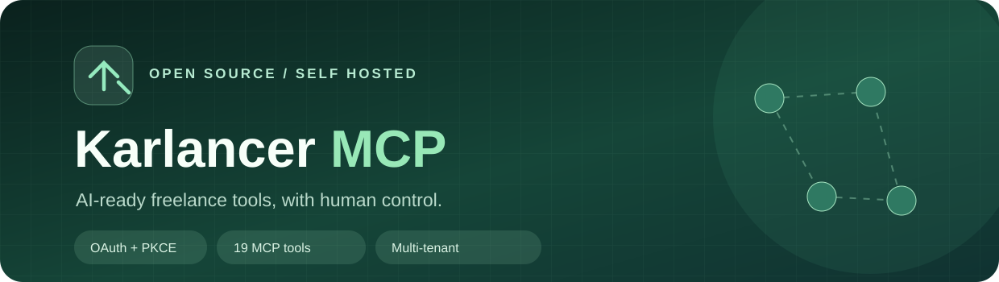

<h1>Karlancer MCP Server</h1>

<strong>Bring your Karlancer freelance workflow to MCP-compatible AI clients — on infrastructure you control.</strong>

[Get started](#quick-start) · [Features](#features) · [MCP tools](#mcp-tools) · [Security](#security) · [Deployment](docs/deployment.md) · [فارسی](docs/README.fa.md)

> [!IMPORTANT]
> **Unofficial integration.** This is not affiliated with or endorsed by Karlancer. It uses observed website endpoints, which may change without notice. Respect the platform's terms, account permissions, rate limits and applicable laws.

## Why this exists

A self-hosted **Model Context Protocol (MCP)** server for connecting a Karlancer account to an AI assistant. The assistant can inspect freelance opportunities, prepare proposals, and manage permitted conversations through **scoped, human-approved tools**. Each person connects their own account via a Persian RTL portal; no one shares their Karlancer password with an AI client.

No built-in autonomous model, paid credit purchasing, or guaranteed winning proposals.

## Features

| | Feature | What you get |
| :--: | --- | --- |
| 🔌 | Remote MCP | Streamable HTTP with scoped tool discovery |
| 🔐 | OAuth authorization | Authorization code, S256 PKCE, dynamic client registration |
| 👥 | Multi-tenant portal | Invitation-based onboarding, per-user account and policies |
| 🛡️ | Guarded writes | Immutable drafts, policy checks, idempotency and recovery states |
| 💼 | Project discovery | Search projects, inspect budgets, plans and included statistics |
| 📝 | Proposals | Prepare, submit, list, view and update your own proposals |
| 💬 | Conversations | Read messages and prepare/send policy-compliant replies |
| 🎛️ | Human controls | Manual vs AI field delegation and limits for financial decisions |
| 🗄️ | Encrypted persistence | Tenant-bound AES-256-GCM storage with SQLite |
| 🧪 | Regression coverage | Local OAuth/MCP tests and simulated upstream fixtures |

<b>Security-first behaviors</b>

- Sending is disabled by default for newly connected accounts.
- Financial floor, maximum duration, daily caps and manual/AI delegation remain human-managed.
- A preparation operation creates a draft; it does not send a real proposal.
- Ambiguous submissions result in UNKNOWN and are never blindly replayed.
- MCP tools cannot purchase premium credits or change owner-only policy.
- Tenant ownership and OAuth scopes limit all accessible records and tools.

## Architecture

~~~mermaid
flowchart LR
  Agent["AI client MCP + OAuth"] --> Auth["OAuth / PKCE"]
  Portal["RTL web portal Human approval"] --> Auth
  Auth --> MCP["Streamable HTTP MCP Tool and policy gates"]
  Portal <--> DB[("Encrypted SQLite")]
  MCP <--> DB
  MCP <--> Karlancer["Karlancer website Observed endpoints"]
~~~

## Quick start

**Prerequisites:** Docker Engine + Compose v2, HTTPS domain, and outbound connectivity to Karlancer. Development requires **Node.js 24+** for node:sqlite.

~~~bash
git clone https://github.com/JavadRostami3/karlancer-mcp-server.git
cd karlancer-mcp-server
cp .env.example .env
openssl rand -hex 32
~~~

Configure the example environment file (do not commit the real one):

~~~dotenv
BASE_URL=https://mcp.example.com
MASTER_KEY=REPLACE_WITH_64_HEX_CHARACTERS
OWNER_PHONE_HASH=REPLACE_WITH_64_HEX_CHARACTERS
PORT=8940
DB_PATH=/app/data/state.sqlite
~~~

Generate OWNER_PHONE_HASH from the initial administrator's Iranian phone **normalized to ten digits** (9xxxxxxxxx, omitting 98 or a leading 0):

~~~bash
OWNER_PHONE="9xxxxxxxxx" node -e "const {createHash}=require('node:crypto');const p=process.env.OWNER_PHONE;if(!/^9[0-9]{9}$/.test(p))throw Error('Expected 9xxxxxxxxx');console.log(createHash('sha256').update(p).digest('hex'))"
~~~

Replace the two placeholders in your private .env. Use the output of openssl as MASTER_KEY. Never regenerate the master key for a database you want to keep.

~~~bash
docker compose up -d --build
curl -fsS http://127.0.0.1:18940/healthz
~~~

The container is bound to **127.0.0.1:18940** by default. Set up a trusted HTTPS reverse proxy for the exact BASE_URL hostname. Then open your public portal at **https://mcp.example.com/** for Karlancer OTP onboarding. Additional people are admitted by owner invitation. See [deployment](docs/deployment.md).

> [!CAUTION]
> The encrypted SQLite volume, your .env file, MASTER_KEY, account cookies and OTPs must **never** be committed or copied into GitHub issues. Keep the matching master key in a separate, protected backup.

## Connect an AI client

Register the remote MCP endpoint **https://mcp.example.com/mcp** in a client supporting Streamable HTTP + OAuth authorization code + resource indicators. Complete the browser authorization and grant only the required scopes.

<b>Generic client configuration example</b>

Some hosts accept a remote definition shaped like this. Exact configuration keys vary by host and version:

~~~json
{
  "servers": {
    "karlancer": {
      "type": "http",
      "url": "https://mcp.example.com/mcp"
    }
  }
}
~~~

The issuer is at /oidc. Protected resource metadata is at /.well-known/oauth-protected-resource/mcp. Client registration uses /oidc/reg. Read [OAuth integration](docs/oauth.md) for exact requirements.

## MCP tools

19 tools, advertised according to tenant-specific OAuth scopes:

| Category | Tools |
| --- | --- |
| Profile and connection | get_connection_status, get_profile, update_profile |
| Discovery and plan | search_projects, get_project, get_plan_usage, get_competition_statistics |
| Proposal lifecycle | prepare_proposal, submit_proposal, list_proposals, get_proposal, prepare_proposal_update, submit_proposal_update |
| Messaging | list_conversations, get_messages, prepare_reply, send_reply, mark_conversation_read |
| Recovery | get_operation_status |

See [src/tool-catalog.ts](src/tool-catalog.ts) for tool schemas and [docs/oauth.md](docs/oauth.md) for scopes.

### Proposal safety lifecycle

~~~mermaid
flowchart TD
  Search["Inspect project and policy"] --> Draft["Prepare immutable draft"]
  Draft --> Gate{"Owner rules + credits pass?"}
  Gate -- No --> Stop["Blocked with reason"]
  Gate -- Yes --> Submit["Submit with stable idempotency key"]
  Submit --> Result{"Authoritative response?"}
  Result -- Yes --> Confirm["Confirmed / actionable result"]
  Result -- Uncertain --> Investigate["UNKNOWN — check operation status; never blindly resend"]
~~~

Commercial terms in outgoing replies can require an owner decision; merely approving a draft does not itself send the reply.

## Security

- **OAuth scopes:** mcp plus profile:read, profile:write, projects:read, proposals:read, proposals:write, conversations:read, conversations:write.
- **Multi-tenancy:** records and account sessions belong to one bound user, with strict ownership checks.
- **Encrypted storage:** confidential session material is tenant-bound and AES-256-GCM protected.
- **Strict OAuth redirects:** HTTPS redirect URI validation and PKCE for public clients.
- **Safe write semantics:** draft preparation, input checks, financial policy, idempotency keys and uncertain-result handling.
- **Logs:** structured safe diagnostic events exclude authorization headers, OTPs, cookies and request/response bodies.

There is no security warranty. Self-hosters must harden TLS, backups, permissions, dependencies and infrastructure. Report issues privately via [SECURITY.md](SECURITY.md).

## Development and tests

~~~bash
npm ci
npm run build
npm test

# Set up your private .env before running locally:
npm run dev
~~~

The regression suite uses local HTTP fixtures, real OAuth provider flows and MCP transport without sending live employer messages or paid operations. GitHub Actions runs build/tests on pushes and PRs.

<b>Repository structure</b>

~~~text
src/                  MCP tools, account adapter, OAuth, domain and portal
tests/                Local regression tests
public/               RTL portal assets and licensed SVG icons
docs/                 Setup, OAuth and Persian guide
.github/workflows/    CI
Dockerfile            Node 24 multi-stage image
compose.yaml          Loopback-only Compose service
.env.example          Safe configuration template
~~~

<b>FAQ — Do I need an LLM API key?</b>

No API key is needed **by this server**. The MCP host/client supplies its own model. This project exposes tools and enforces policy; it is not a background AI agent.

<b>FAQ — Is this an official or guaranteed stable API?</b>

No. Upstream endpoints are observed website interfaces. Their behavior can change without notice. Terms, quotas, account state and login requirements apply.

## Contributing and license

Contributions are welcome for safer workflows, compatibility, localization and fixture coverage. Please read [CONTRIBUTING.md](CONTRIBUTING.md). Report vulnerabilities privately, not in public issues.

Licensed under [MIT](LICENSE). Karlancer is a trademark of its respective owner. This independent project is **not an official product**.

**Own your workflow. Keep humans in control.**

[Open an issue](https://github.com/JavadRostami3/karlancer-mcp-server/issues/new/choose) · [Deployment](docs/deployment.md) · [فارسی](docs/README.fa.md)

